# Agent Panel for Claude Code

**See what every subagent is doing, live.** One row per agent: its job, type, model, effort, tokens, time, memory and progress.

[Русская версия](README.ru.md)

[](LICENSE) [](LICENSE-ART) [](https://github.com/diveylaunch/claude-code-mods/releases)

<p align="center">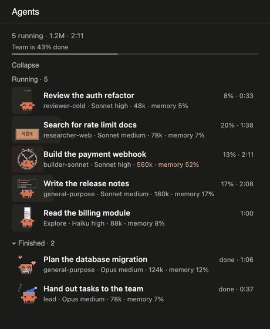</p>
<p align="center"><sub>A sample session drawn by the panel's own code. <a href="assets/demo/demo-en.mp4">Watch the video</a></sub></p>

## Install

In Claude Code:

```
/plugin marketplace add diveylaunch/claude-code-mods
/plugin install agent-panel@claude-code-mods
```

Start a new session. The panel opens when the first subagent starts. To open or close it yourself:

```
/agent-panel
```

`/agent-panel` toggles the panel, `/agent-panel open` only opens it.

## What each part means

<p align="center">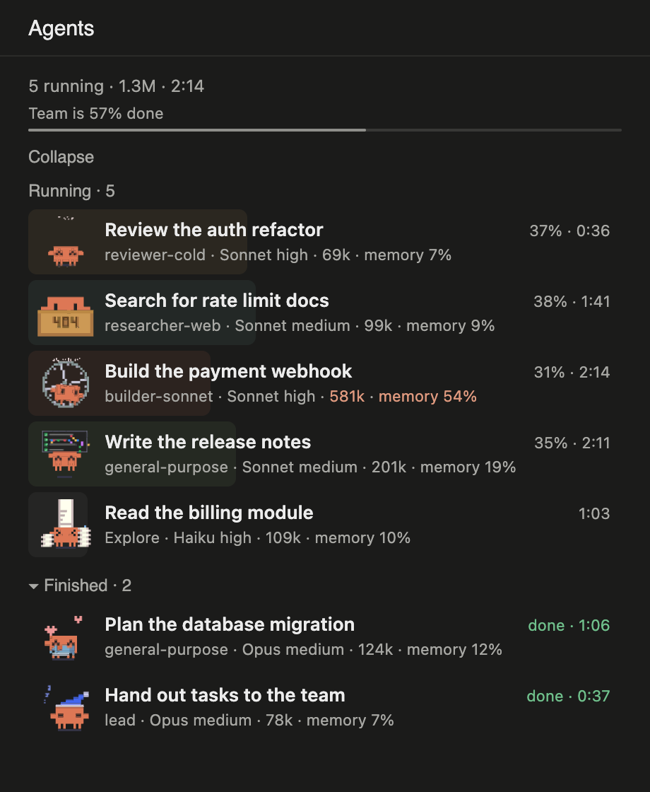</p>

| On screen | Meaning |
|---|---|
| Filled row | How far along the agent is. The color shows the kind of work: code, review, content, search. |
| Team line | Average progress of the whole team. |
| `reviewer-cold` | The agent type, as Claude Code names it. |
| `Sonnet high` | Model and effort. |
| `401k` | Tokens the agent has used. The largest spend, and anything from 400k, turns orange. |
| `memory 54%` | How full the agent's context is. Near 100% Claude Code has to compact it and details can get lost. From 50% it turns orange. |
| `31% · 2:14` | Progress and time worked. |

When everything is finished the panel says so, and the last agent heads home:

<p align="center">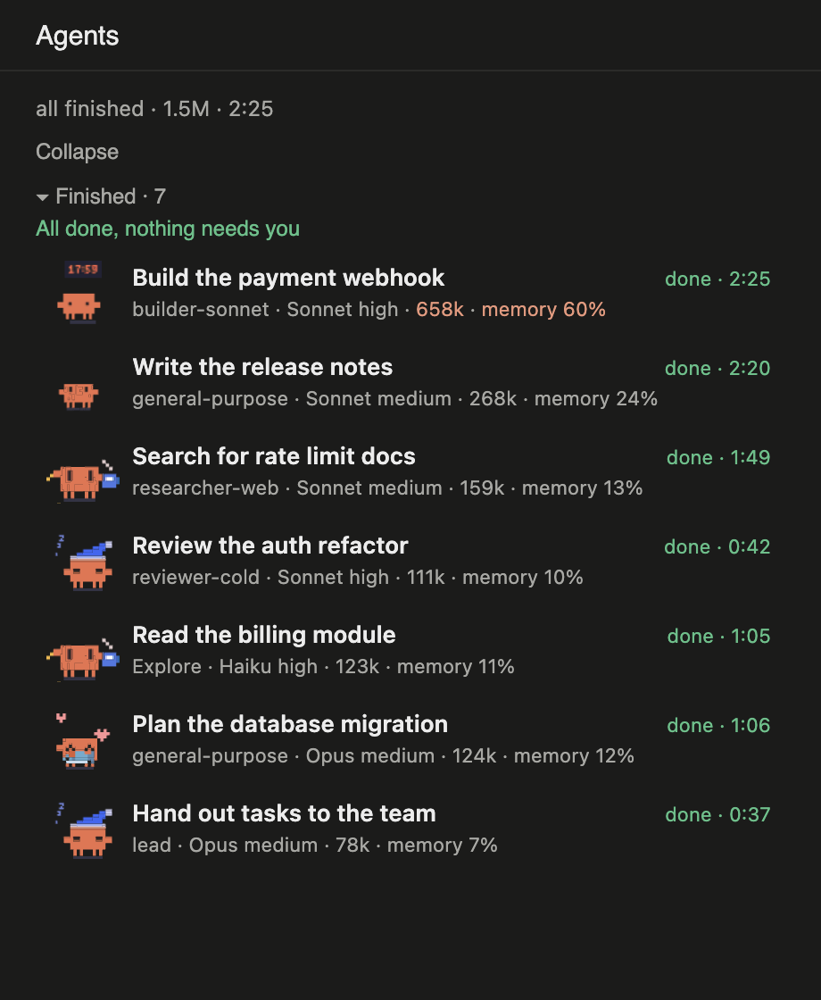 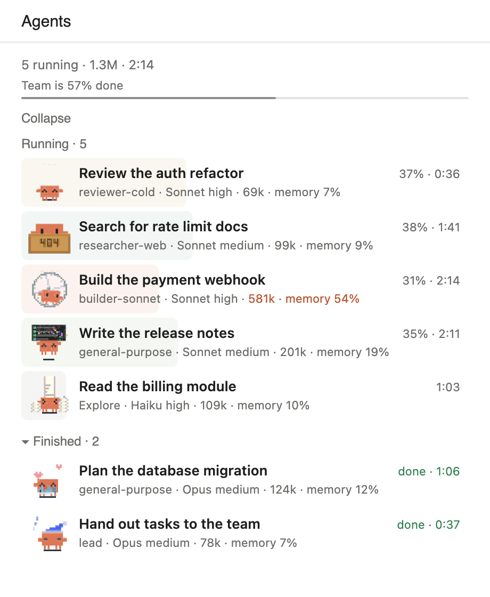</p>

## Stickers

21 animated stickers. The panel picks one from the words in the agent's type and title, in English or Russian.

<table>
<tr><td align="center">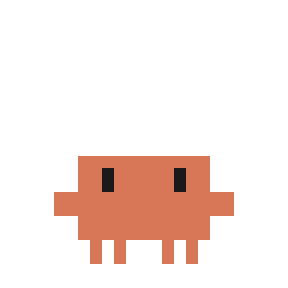<br><sub>Writing code</sub></td><td align="center">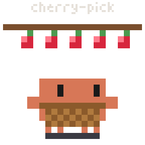<br><sub>Writing code</sub></td><td align="center">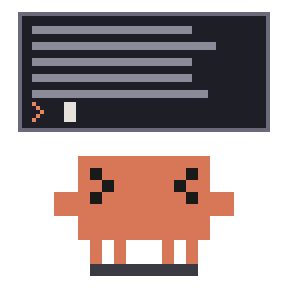<br><sub>Writing code or making art</sub></td><td align="center">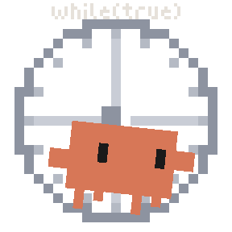<br><sub>Building</sub></td></tr>
<tr><td align="center">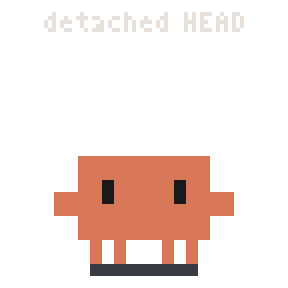<br><sub>Fixing a bug</sub></td><td align="center">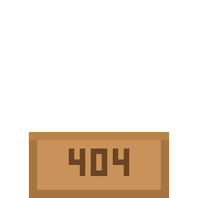<br><sub>Fixing or searching</sub></td><td align="center">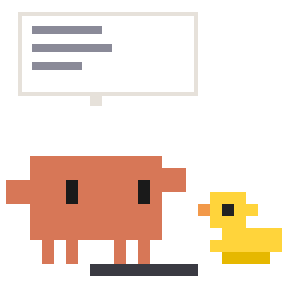<br><sub>Reviewing</sub></td><td align="center">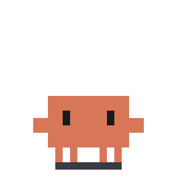<br><sub>Reviewing</sub></td></tr>
<tr><td align="center">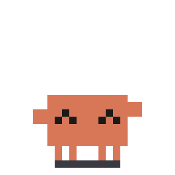<br><sub>Reading</sub></td><td align="center">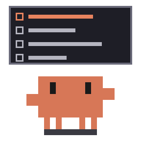<br><sub>Writing text</sub></td><td align="center">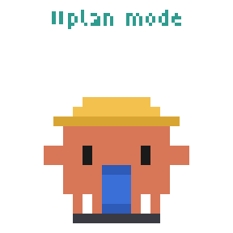<br><sub>Planning</sub></td><td align="center"><br><sub>Thinking hard</sub></td></tr>
<tr><td align="center">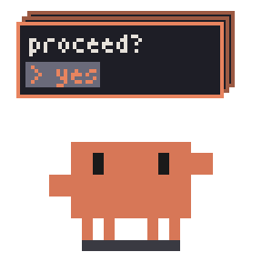<br><sub>Thinking</sub></td><td align="center">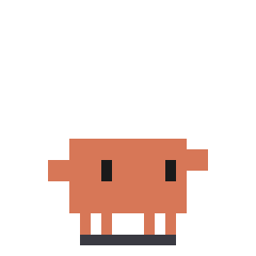<br><sub>Leading the team</sub></td><td align="center">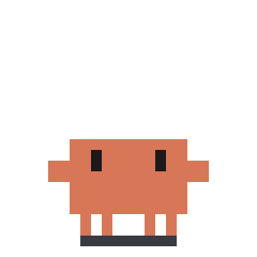<br><sub>Just finished</sub></td><td align="center">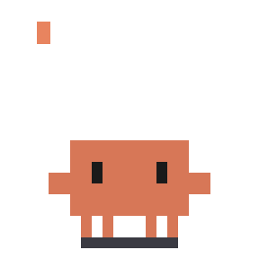<br><sub>Lead finished</sub></td></tr>
<tr><td align="center">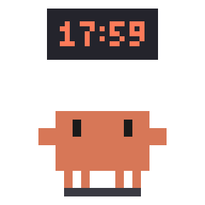<br><sub>Last agent, all work done</sub></td><td align="center">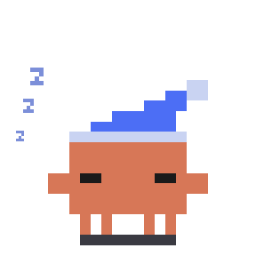<br><sub>Resting</sub></td><td align="center">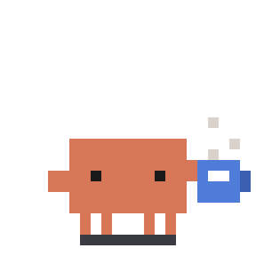<br><sub>Resting</sub></td><td align="center">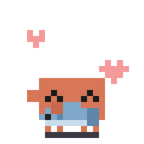<br><sub>Resting</sub></td></tr>
<tr><td align="center">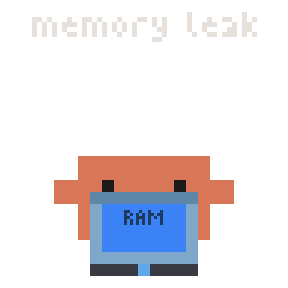<br><sub>Agent failed</sub></td></tr>
</table>

## Settings

Add to `~/.claude/settings.json`:

```json
{ "pluginConfigs": { "agent-panel": { "options": { "language": "en" } } } }
```

| Option | Values | What it does |
|---|---|---|
| `language` | `auto`, `en`, `ru`, `he` | Panel language. |
| `autoOpen` | `first`, `off` | Open on the first subagent, or only with `/agent-panel`. |
| `reportProgress` | `on`, `off` | See below. |

## How progress works

Claude Code does not report how far along a subagent is. So the mod adds a short note, about 40 words, to each subagent's prompt, asking it to report its steps through a small `step` tool. That is where the percent comes from.

With `reportProgress: off` the note is not added, though the `step` tool stays in the agent's tool list. A row then fills in grey by memory use and shows no percent. The same happens if an agent ignores the request.

The token and memory numbers come from Claude Code itself.

## Privacy

The mod runs inside Claude Code and makes no network requests. It reads agent types, task titles, models and token counts to draw the panel, and stores nothing outside the session.

## Limits

- The graphical panel is for the desktop app. In a terminal you get a text version without stickers.
- In Hebrew the headings and buttons are translated, row labels stay in English, and rows run left to right.
- Built and checked on macOS with Claude Code 2.1.317.

## Remove

```
/plugin uninstall agent-panel@claude-code-mods
/plugin marketplace remove claude-code-mods
```

## More mods

This repository is a marketplace: new mods will land in `plugins/`. Star it to follow along. Bugs and ideas go to [Issues](https://github.com/diveylaunch/claude-code-mods/issues).

## Credits and license

- Code: MIT, see [LICENSE](LICENSE). Based on [savvy-progress](https://github.com/johnnyvizz/claude-kit/tree/main/plugins/savvy-progress) by johnnyvizz.
- Stickers: [clawd-stickers](https://github.com/alwinecor/clawd-stickers) by alwinecor, CC BY-NC-SA 4.0, see [LICENSE-ART](LICENSE-ART). Non-commercial use only.
- Clawd belongs to Anthropic. This is an unofficial fan project, not affiliated with or endorsed by Anthropic. Details in [NOTICE.md](NOTICE.md).
