# Agent Panel для Claude Code

**Видно, чем занят каждый субагент, прямо во время работы.** На агента одна строка: задача, тип, модель, effort, токены, время, память и готовность.

[English version](README.md)

<p align="center">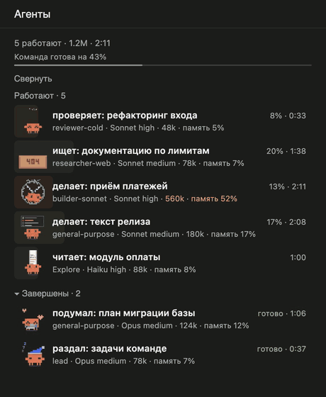</p>
<p align="center"><sub>Пример сессии, нарисованный кодом самой панели. <a href="assets/demo/demo-ru.mp4">Смотреть видео</a></sub></p>

## Установка

В Claude Code:

```
/plugin marketplace add diveylaunch/claude-code-mods
/plugin install agent-panel@claude-code-mods
```

Откройте новую сессию. Панель появится сама при первом субагенте. Открыть или закрыть вручную:

```
/agent-panel
```

`/agent-panel` переключает панель, `/agent-panel open` только открывает.

## Что где показано

<p align="center">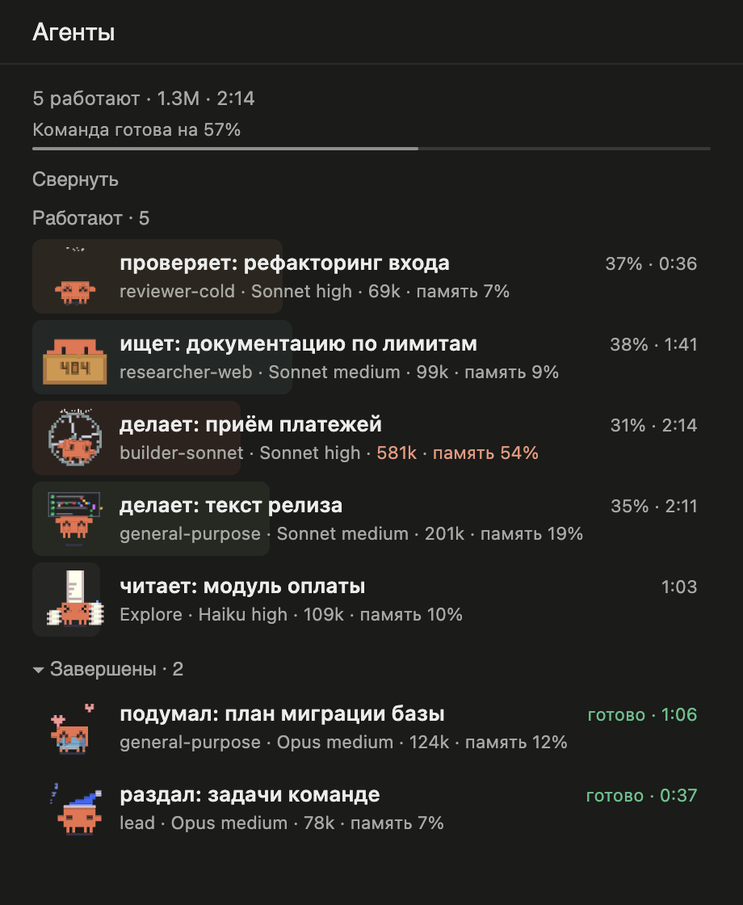</p>

| На экране | Что значит |
|---|---|
| Заполненная строка | Насколько готов агент. Цвет показывает род работы: код, проверка, контент, поиск. |
| Строка команды | Средняя готовность всей команды. |
| `reviewer-cold` | Тип агента, как его называет Claude Code. |
| `Sonnet high` | Модель и effort. |
| `401k` | Сколько токенов потратил агент. Самый большой расход и всё от 400k выделяется оранжевым. |
| `память 54%` | Насколько занята память агента. Ближе к 100% Claude Code сжимает её, и детали могут потеряться. От 50% цифра оранжевая. |
| `31% · 2:14` | Готовность и время работы. |

Когда всё закончено, панель об этом пишет, а последний агент уходит домой:

<p align="center">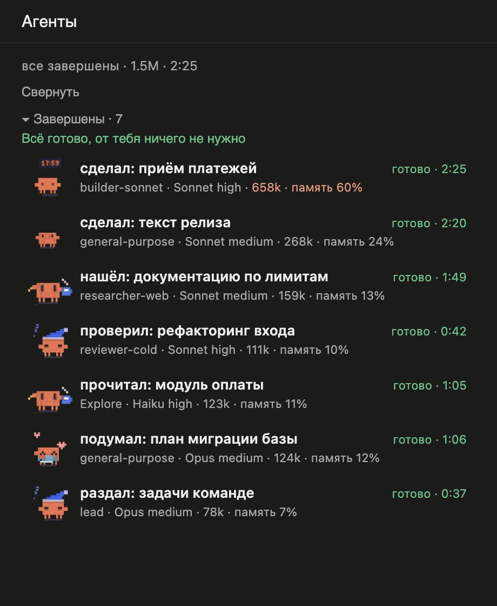 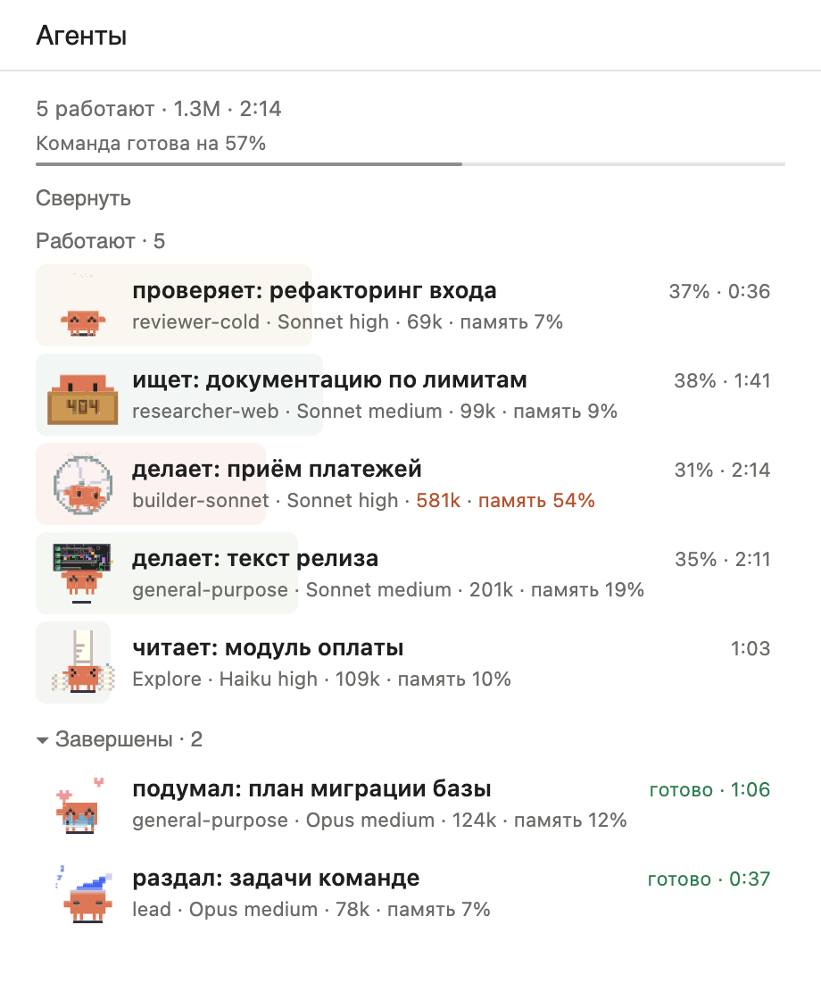</p>

## Стикеры

21 анимированный стикер. Панель выбирает его по словам в типе и названии агента, на русском или английском.

<table>
<tr><td align="center">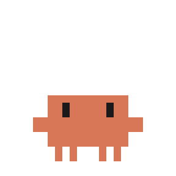<br><sub>Пишет код</sub></td><td align="center">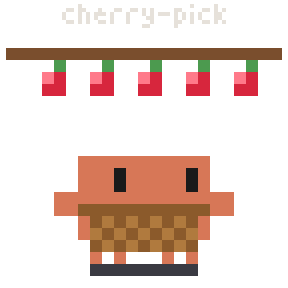<br><sub>Пишет код</sub></td><td align="center">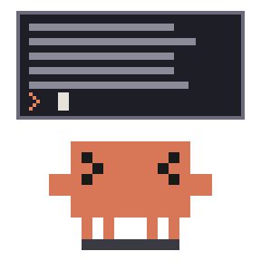<br><sub>Пишет код, рисует</sub></td><td align="center">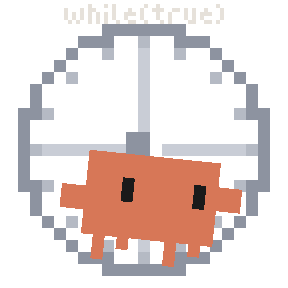<br><sub>Собирает проект</sub></td></tr>
<tr><td align="center">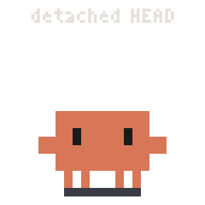<br><sub>Чинит ошибку</sub></td><td align="center">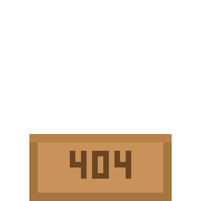<br><sub>Чинит, ищет</sub></td><td align="center">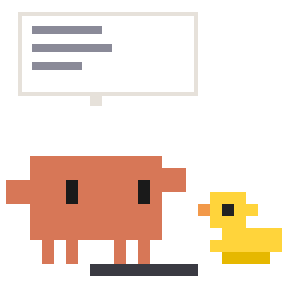<br><sub>Проверяет</sub></td><td align="center">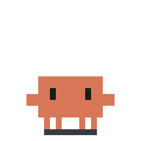<br><sub>Проверяет</sub></td></tr>
<tr><td align="center">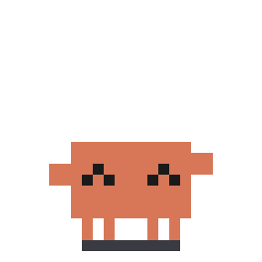<br><sub>Читает</sub></td><td align="center">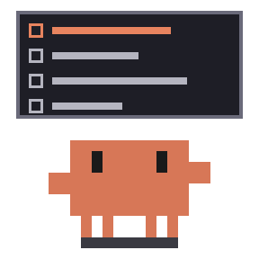<br><sub>Пишет текст</sub></td><td align="center">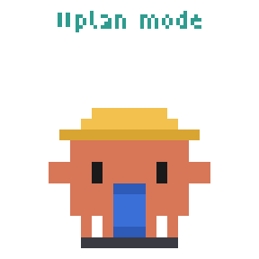<br><sub>Планирует</sub></td><td align="center"><br><sub>Думает</sub></td></tr>
<tr><td align="center">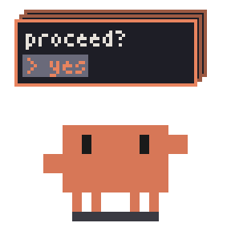<br><sub>Думает</sub></td><td align="center">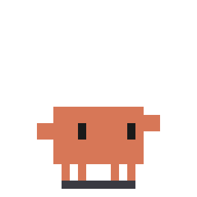<br><sub>Раздаёт задачи</sub></td><td align="center">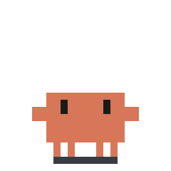<br><sub>Только что закончил</sub></td><td align="center">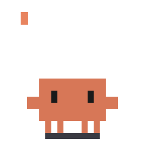<br><sub>Лидер закончил</sub></td></tr>
<tr><td align="center">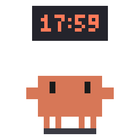<br><sub>Последний, всё закончено</sub></td><td align="center">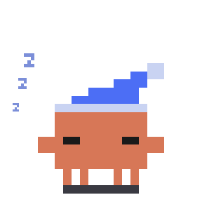<br><sub>Отдыхает</sub></td><td align="center">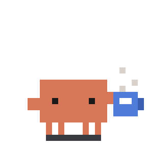<br><sub>Отдыхает</sub></td><td align="center">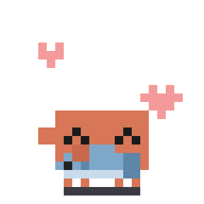<br><sub>Отдыхает</sub></td></tr>
<tr><td align="center">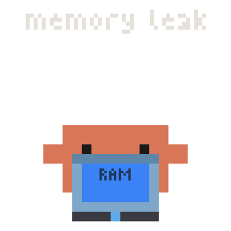<br><sub>Агент упал</sub></td></tr>
</table>

## Настройки

В `~/.claude/settings.json`:

```json
{ "pluginConfigs": { "agent-panel": { "options": { "language": "ru" } } } }
```

| Настройка | Значения | Что делает |
|---|---|---|
| `language` | `auto`, `en`, `ru`, `he` | Язык панели. |
| `autoOpen` | `first`, `off` | Открывать при первом субагенте или только по `/agent-panel`. |
| `reportProgress` | `on`, `off` | См. ниже. |

## Откуда берутся проценты

Claude Code не сообщает, насколько готов субагент. Поэтому мод добавляет в задание каждого субагента короткую просьбу, около 40 слов, отмечать шаги через маленький инструмент `step`. Из этих отметок и получается процент.

С `reportProgress: off` просьба не добавляется, инструмент `step` остаётся в списке агента. Строка тогда заполняется серым по занятой памяти, процента нет. То же будет, если агент просьбу проигнорирует.

Токены и память приходят от самого Claude Code.

## Приватность

Мод работает внутри Claude Code и не ходит в сеть. Он читает типы агентов, названия задач, модели и счётчики токенов, чтобы нарисовать панель, и ничего не хранит вне сессии.

## Ограничения

- Графическая панель сделана для настольного приложения. В терминале показывается текстовый вид без стикеров.
- На иврите переведены заголовки и кнопки, подписи строк остаются английскими, строки идут слева направо.
- Собрано и проверено на macOS с Claude Code 2.1.317.

## Удаление

```
/plugin uninstall agent-panel@claude-code-mods
/plugin marketplace remove claude-code-mods
```

## Другие моды

Этот репозиторий работает как маркетплейс, новые моды будут появляться в `plugins/`. Поставьте звезду, чтобы не пропустить. Ошибки и идеи пишите в [Issues](https://github.com/diveylaunch/claude-code-mods/issues).

## Авторы и лицензии

- Код: MIT, см. [LICENSE](LICENSE). Основан на [savvy-progress](https://github.com/johnnyvizz/claude-kit/tree/main/plugins/savvy-progress) от johnnyvizz.
- Стикеры: [clawd-stickers](https://github.com/alwinecor/clawd-stickers) от alwinecor, CC BY-NC-SA 4.0, см. [LICENSE-ART](LICENSE-ART). Только некоммерческое использование.
- Clawd принадлежит Anthropic. Это неофициальный фанатский проект, Anthropic к нему отношения не имеет. Подробности в [NOTICE.md](NOTICE.md).
